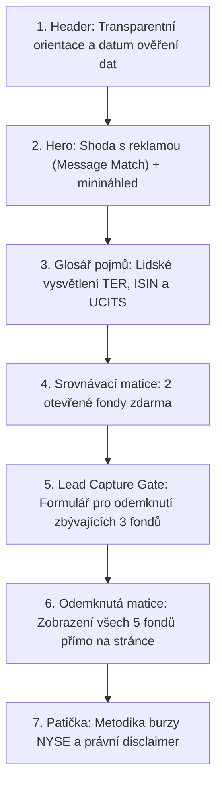

# ETF Landing Page: Srovnání amerických ETF (NYSE) a evropských alternativ

**Stav projektu:** Dokončená implementace aplikace a lokální verifikace (provozní nasazení na Vercel a konfigurace cloudové databáze Neon zůstávají otevřené pro produkční fázi)  
**Poslední aktualizace dokumentace:** 29. 10. 2026  
**Datum ověření finančních dat:** 28. 10. 2026  

---

## 1. Cíl projektu a řešený problém

### Cílová skupina
Cílovou skupinou jsou čeští drobní (retailoví) investoři, kteří se zajímají o americké akciové a dluhopisové trhy, sledují zahraniční finanční média nebo sociální sítě a hledají způsob, jak efektivně investovat prostřednictvím ETF.

### Řešený problém
1. **Regulační bariéra (PRIIPs):** Od zavedení evropské regulace PRIIPs vyžaduje legislativa EU, aby fondy nabízené běžným retailovým investorům měly vydaný standardizovaný dokument klíčových informací (KID) v národním jazyce. Americká ETF obchodovaná na New York Stock Exchange (NYSE) tento evropský dokument nevydávají, protože podléhají výhradně americké komisi SEC. Většina běžných brokerů v ČR (např. XTB, Fio e-Broker, Degiro, Portu) proto přímý nákup těchto fondů retailovým klientům neumožňuje.
2. **Informační asymetrie a hledání alternativ:** Investor se v zahraničních analýzách dočte o konkrétním americkém fondu, ale v aplikaci svého brokera ho nenajde. Dohledat odpovídající evropskou alternativu v režimu UCITS, která má stejné sektorové zaměření, doložitelný ISIN kód a transparentní poplatky, je pro běžného investora časově náročné a vyžaduje studium stovek stran prospektů.
3. **Zkreslená představa o poplatcích:** V diskusích se často uvádí, že evropské fondy jsou „drahé“ oproti americkým, nebo se naopak rozdíl v nákladech prezentuje jako čistá úspora, aniž by se rozlišovalo, zda fondy kopírují stejný index, nebo mají zcela odlišnou strategii správy.

### Cíl landing page
Vytvořit responzivní, mobilně orientovanou landing page, která návštěvníkovi přicházejícímu z online reklamy během prvních okamžiků srozumitelně předá konkrétní hodnotu (bezplatné srovnání 2 sektorových fondů) a následně nabídne odemknutí kompletního srovnání všech 5 fondů výměnou za e-mailový kontakt.

---

## 2. Nabízená hodnota (Lead Magnet)

Hlavní hodnotou pro návštěvníka není obecná e-kniha nebo PDF ke stažení, ale **interaktivní datové srovnání přímo na stránce**:

- **Okamžitá hodnota bez zadání e-mailu (Freemium ukázka):** Návštěvník ihned vidí plné srovnání prvních 2 sektorových dvojic fondů:
  1. Energetický sektor: `DRLL` (Strive) vs. `SXLE` (SPDR)
  2. Polovodičový sektor: `SHOC` (Strive) vs. `SMH` (VanEck)  
  U každé dvojice vidí přesné náklady fondu, sledovaný index, diverzifikační pravidla, instrukce pro brokera a odkazy na primární prospekty.
- **Hodnota odemknutelná e-mailem:** Po zadání e-mailu a jeho perzistentním uložení server do stránky doručí data zbývajících 3 specializovaných fondů:
  3. Krátkodobý dolarový výnos: `BUXX` (Strive / Angel Oak) vs. `JPSA` (J.P. Morgan)
  4. Široký dluhopisový trh USA: `BOND` (PIMCO) vs. `USAG` (SPDR)
  5. Akcie rozvíjejících se trhů: `BCEM` (Baron Capital) vs. `JREM` (J.P. Morgan)
- **Okamžité doručení na stránce (On-page Unlocking):** Žádné přesměrování na externí disky, stahování PDF ani čekání na doručovací e-mail. Tabulka se plynule rozšíří přímo před očima návštěvníka.

---

## 3. Uživatelská cesta a zdůvodnění pořadí sekcí

Pořadí sekcí na stránce vychází z principu postupného budování důvěry a snižování tření pro mobilního návštěvníka:



### Zdůvodnění pořadí jednotlivých sekcí:
1. **Záhlaví (Header):**  
   *Proč je první:* Poskytuje okamžité institucionální ukotvení. Obsahuje odznak s přesným datem ověření dat (`28. 10. 2026`), což signalizuje aktuálnost a serióznost finančního obsahu.
2. **První obrazovka (Hero):**  
   *Proč navazuje:* Zajišťuje shodu sdělení s reklamním úhlem (*Message Match*). Pokud návštěvník klikl na reklamu o poplatcích nebo o nedostupnosti amerických fondů, titulek a podtitulek mu v přirozené češtině potvrdí, že je na správném místě. Součástí je kompaktní vizuální minináhled srovnání, takže reálná data vidí ještě před prvním posunem stránky.
3. **Lidský glosář pojmů (Glossary Accordion):**  
   *Proč je před tabulkou:* Běžný investor se často ztrácí v pojmech TER, ISIN, UCITS nebo KID. Rozbalovací glosář mu srozumitelně na příkladu v českých korunách (např. 150 Kč ročně na 100 000 Kč investice) vysvětlí, co zkratky znamenají, jak funguje kód pro brokera a proč americká ETF nemají český KID.
4. **Jádro srovnání zdarma (Otevřená ukázka):**  
   *Proč je před formulářem:* Požadovat e-mail předem bez prokázané hodnoty u finančního tématu vyvolává skepsi. Návštěvník nejprve prozkoumá dvě kompletní srovnání, ověří si odbornou úroveň i primární odkazy na SEC a emitenty.
5. **E-mailová brána (Lead Capture Gate):**  
   *Proč následuje až zde:* Návštěvník v tabulce výše zřetelně vidí, že existují další 3 zamčené fondy. Ve chvíli, kdy dorazí k formuláři, přesně ví, co získá. Formulář vyžaduje pouze e-mail (žádné telefonní číslo ani jméno), nabízí nativní mobilní autofill a je podpořen mikro-ujištěním, že data se odemknou ihned na této stránce.
6. **Patička a metodika (Footer & Legal Disclaimer):**  
   *Proč je na konci:* Shrnuje metodiku výběru primárního listingu na NYSE (MIC kód `XNYS`) a uvádí zákonné poučení podle zákona č. 256/2004 Sb., o podnikání na kapitálovém trhu.

---

## 4. Reklamní varianty a jejich návaznost na první obrazovku

Pro kampaň jsou definovány dvě reklamní varianty testující dva odlišné motivy investorů. Obě varianty směřují na stejnou aplikaci, kde parametr `utm_content` v URL dynamicky řídí sdělení první obrazovky:

### Varianta A – Nákladovost a poplatky (`/?utm_content=fees`)
* **Reklamní motiv:** Zaměřeno na investory citlivé na nákladovost a poplatky správců fondů.
* **Titulek reklamy:** Kolik stojí ETF zalistovaná na NYSE a jaké mají evropské alternativy?
* **Text reklamy:** Srovnáváme roční náklady (Expense Ratio vs. TER) vybraných ETF z burzy NYSE a jejich evropských protějšků. Zjistěte, v čem se fondy liší a proč nižší poplatek nemusí znamenat stejnou strategii.
* **Návaznost v Hero sekci:**
  * **Nadpis:** *„Kolik stojí ETF zalistovaná na burze NYSE a jak se liší od evropských alternativ?“*
  * **Podnadpis:** *„Srovnáváme vybraná ETF s primárním listingem na burze NYSE a jejich evropské UCITS protějšky. Podívejte se na roční poplatky (Expense Ratio vs. TER), sledované indexy a zjistěte, proč odlišná nákladovost nemusí znamenat identickou investiční strategii.“*
  * **Vizuální akcent:** Důraz na porovnání nákladů a vysvětlení rozdílu v poplatcích.

### Varianta B – Evropské alternativy a dostupnost (`/?utm_content=alternatives`)
* **Reklamní motiv:** Zaměřeno na investory, kteří zjistili, že americké ETF nelze u běžného brokera v ČR koupit, a hledají řešení.
* **Titulek reklamy:** Hledáte evropské UCITS alternativy k americkým ETF?
* **Text reklamy:** Mnohá americká ETF nejsou pro retailové investory v EU u běžných brokerů dostupná kvůli chybějícímu KID. Připravili jsme přehled evropských UCITS fondů se stejným zaměřením a platnými ISIN kódy.
* **Návaznost v Hero sekci:**
  * **Nadpis:** *„Mnohá americká ETF nejsou u běžných brokerů dostupná. Zde jsou jejich evropské alternativy.“*
  * **Podnadpis:** *„Z důvodu chybějícího klíčového informačního dokumentu (PRIIPs KID) většina běžných brokerů v EU neumožňuje retailovým klientům přímý nákup těchto amerických fondů. Připravili jsme přehled evropských UCITS alternativ se stejným zaměřením, ověřenými ISIN kódy a srozumitelným vysvětlením rozdílů.“*
  * **Vizuální akcent:** Důraz na dostupnost v ČR a pravidla diverzifikace UCITS.

*Výchozí chování:* Pokud uživatel přijde bez parametru `utm_content`, aplikace načte jako výchozí variantu `fees`.

---

## 5. Očekávaná konverze, předpoklady a metodické rozlišení

> [!IMPORTANT]
> **Metodické rozlišení statusu informací v tomto projektu:**
> - **Návrhové rozhodnutí:** Architektonické nebo obsahové řešení zvolené na základě osvědčených postupů (např. mobilní vertikální tok karet, freemium model se 2 fondy zdarma, serverové gating dat).
> - **Pracovní hypotéza:** Předpoklad o chování uživatelů, který bude ověřen až v reálném provozu s placenou návštěvností (např. odhadovaný konverzní poměr 3 %, předpokládaný relativní dopad A/B testů).
> - **Skutečně ověřený výsledek:** Stav technicky otestovaný v kódu, testovacích skriptech a prohlížeči (např. nulové horizontální přetékání, chování API při výpadku databáze, HTTP statusy odkazů).

### Pracovní hypotéza konverzního poměru (3 %)
Pro úvodní ekonomickou rozvahu pracujeme s hypotézou celkového konverzního poměru **3 %**.

$$\text{Konverzní poměr} = \frac{\text{Počet návštěvníků s úspěšně uloženým kontaktem}}{\text{Celkový počet návštěvníků landing page}} \times 100\,\%$$

### Důvody volby této hodnoty a výchozí předpoklady:
1. **Benchmarky studené mobilní návštěvnosti:** Ve finančním segmentu v ČR (Meta Ads, Google Ads) se konverze studené návštěvnosti na stránkách sbírajících kontakty obvykle pohybuje v rozmezí **1,5 % až 4 %**. Vyšší čísla bývají nereálná kvůli přirozené skepsi uživatelů vůči finančním nabídkám na internetu.
2. **Minimalizace tření:** Formulář nevyžaduje telefonní číslo (které v mobilních formulářích představuje zásadní bariéru) ani jméno. Vyžaduje výhradně e-mailovou adresu a využívá systémový našeptávač klávesnice.
3. **Okamžitá hodnota před formulářem:** Návštěvník neodevzdává kontakt naslepo. Dvě kompletní srovnání si prohlédne ihned, čímž si ověří věcnou kvalitu dat.
4. **On-page doručení bez PDF:** Okamžité odemknutí přímo ve srovnávací tabulce eliminuje ztráty způsobené stahováním souborů nebo hledáním e-mailů ve složce hromadné pošty.

Tato hodnota je **výslovně pracovní hypotézou**, nikoliv naměřeným faktem.

---

## 6. Hypotézy pro A/B testování

Hypotézy jsou seřazeny podle předpokládaného významu jejich vlivu na konverzi (od nejvyššího k nejnižšímu):

### 1. Shoda sdělení první obrazovky s reklamou (Message Match)
* **Předpokládaný vliv:** **Vysoký** (klíčový faktor pro snížení míry okamžitého odchodu).
* **Pracovní hypotéza:** Přesná textová i vizuální shoda titulku s konkrétním úhlem reklamy (nákladovost na burze NYSE vs. evropské alternativy k nedostupným fondům) udrží návštěvníka na stránce v prvních okamžicích a povede k vyššímu počtu návštěvníků, kteří prozkoumají srovnání.
* **Zdůvodnění:** Pokud uživatel klikne na reklamu slibující alternativy pro ČR, ale stránka by začínala obecným textem o poplatcích bez zmínky o brokerech, vyhodnotí stránku jako nerelevantní a odejde.
* **Sledované metriky:** Míra prokliku ke srovnání (`comparison_interaction` / `landing_view`) a celkový konverzní poměr (`lead_submit_success` / `landing_view`).

### 2. Hloubka bezplatné ukázky před formulářem (Freemium Depth)
* **Předpokládaný vliv:** **Střední**.
* **Pracovní hypotéza:** Zobrazení právě 2 bezplatných srovnání dosáhne lepšího konverzního poměru než model s 0 otevřenými fondy (plně uzamčený obsah) i model s 5 otevřenými fondy (vše zdarma bez motivace zadat kontakt).
* **Zdůvodnění:** 0 otevřených fondů působí nedůvěryhodně (uživatel neví, jaká data získá). 5 otevřených fondů eliminuje jakoukoliv hodnotu uzamčeného obsahu. Dva fondy demonstrují metodiku a vzbuzují zájem o zbývající kategorie (dluhopisy, peněžní trh, rozvíjející se trhy).
* **Sledované metriky:** Míra zahájení vyplňování formuláře (`lead_form_start`) a podíl uživatelů klikajících na tlačítka uzamčených karet.

### 3. Formulářová mikro-ujištění a akční text tlačítka (CTA & Trust Microcopy)
* **Předpokládaný vliv:** **Nižší až střední**.
* **Pracovní hypotéza:** Specifický text tlačítka („Odemknout srovnání“) doplněný explicitním ujištěním („Odemkne se ihned ve srovnání výše • Žádné stahování souborů ani PDF • 100% zdarma bez závazků“) dosáhne vyšší míry dokončení formuláře než generické tlačítko „Odeslat“.
* **Zdůvodnění:** Odstraňuje obavu, že po odeslání začne stahování velkého PDF souboru nebo že uživatel vstupuje do placeného závazku.
* **Sledované metriky:** Poměr dokončených odeslání vůči zahájeným vyplněním (`lead_submit_success` / `lead_form_start`).

---

## 7. Finanční data, ETF a metodika ověřování

**Datum kontroly dat: 28. 10. 2026.**  
Všechny údaje vycházejí přímo z oficiálních podání u Komise pro cenné papíry USA (SEC EDGAR), oficiálních dokumentů správců (PIMCO, Strive / Empowered Funds, Baron Capital, SSGA / SPDR, VanEck, J.P. Morgan Asset Management) a nezávislých profilů JustETF.

### Pravidla výběru fondů do srovnání:
1. **Striktní primární listing na NYSE:** Do výběru amerických ETF jsou zařazeny výhradně fondy s doloženým primárním listingem přímo na hlavní burze **New York Stock Exchange (NYSE, provozní MIC kód: `XNYS`)**. Fondy zalistované na platformách NYSE Arca (`ARCX`) nebo Nasdaq (`XNAS`) nesplňují podmínky tohoto projektu a jsou vyloučeny.
2. **Přesné označování nákladů:** Důsledně se rozlišuje terminologie emitentů: `Expense Ratio`, `Net Expense Ratio` (se smluvním snížením poplatků / waiverem), `Gross Expense Ratio` a evropský ukazatel `TER (Total Expense Ratio)`.
3. **Věcné srovnání strategií (žádná nepodložená tvrzení o úspoře):** Rozdíl mezi náklady např. 0,41 % a 0,15 % činí **0,26 procentního bodu (p.b.)**. Tento rozdíl není v dokumentaci ani v aplikaci paušálně označován za „úsporu pro investora“, protože fondy nesledují identické indexy ani nemají shodná diverzifikační pravidla.

---

### Tabulka 1: Výběr pěti amerických ETF zalistovaných na NYSE

| Ticker | Název fondu | Primární burza | Roční náklady (oficiální údaj) | Investiční strategie a sledovaný index | Primární zdroje (kontrola 28. 10. 2026) |
|:---:|---|:---:|:---:|---|---|
| **`DRLL`** | Strive U.S. Energy ETF | **NYSE** (`XNYS`) | Expense Ratio: **0,41 %** | Pasivní expozice americkému energetickému sektoru (Exxon, Chevron). Index: **Bloomberg US Energy Select Index** (změna indexu platí od 11. 4. 2024). Inception: 8. 8. 2022. | [Produktový profil Strive](https://www.strivefunds.com/drll) · [Prospekt fondu (PDF)](https://www.strivefunds.com/documents/FG/strive_funds/fund_docs/638127_Strive_Prospectus.pdf) |
| **`SHOC`** | Strive U.S. Semiconductor ETF | **NYSE** (`XNYS`) | Expense Ratio: **0,40 %** | Pasivní expozice americkým polovodičovým lídrům. Index: **Bloomberg US Listed Semiconductors Select Total Return Index** (od 21. 3. 2024). Inception: 5. 10. 2022. | [Produktový profil Strive](https://www.strivefunds.com/shoc) · [Prospekt fondu (PDF)](https://www.strivefunds.com/documents/FG/strive_funds/fund_docs/638127_Strive_Prospectus.pdf) |
| **`BUXX`** | Strive Enhanced Income Short Maturity ETF | **NYSE** (`XNYS`) | Expense Ratio: **0,26 %** | Aktivně řízené ETF zaměřené na krátkodobá aktiva investičního stupně ve strukturovaném úvěru (CLO, ABS) a podnikových dluhopisech. **Nesleduje pasivní index**. Inception: 9. 8. 2023. | [Produktový profil Strive](https://www.strivefunds.com/buxx) · [Prospekt BUXX (PDF)](https://www.strivefunds.com/documents/FG/strive_funds/fund_docs/638178_Strive_Prospectus.pdf) |
| **`BOND`** | PIMCO Active Bond Exchange-Traded Fund | **NYSE** (`XNYS`) | Net Expense Ratio: **0,54 %** (Gross: **0,56 %**; smluvní waiver 0,02 p.b. sjednán do 31. 10. 2026, po tomto datu nutno ověřit obnovení či návrat na 0,56 %) | Aktivně řízené portfolio kvalitních dluhopisů investičního stupně. Srovnávací benchmark: **Bloomberg U.S. Aggregate Index**. Inception: 29. 2. 2012 (převod na NYSE: 14. 11. 2022). | [Produktová stránka PIMCO](https://www.pimco.com/us/en/investments/etf/pimco-active-bond-exchange-traded-fund/usetf-usd) · [SEC Form N-CSR (Listing NYSE)](https://www.sec.gov/Archives/edgar/data/1450011/000119312526382370/d105698dncsr.htm) |
| **`BCEM`** | Baron Emerging Markets Select ETF | **NYSE** (`XNYS`) | Total Fund Operating Expenses: **0,80 %** (Management fee: 0,80 %) | Aktivně řízený koncentrovaný výběr růstových lídrů na rozvíjejících se trzích. Srovnávací benchmark: **MSCI Emerging Markets Index**. Inception: 8. 4. 2026. | [Produktová stránka Baron](https://www.baroncapitalgroup.com/product-detail/baron-emerging-markets-select-etf-bcem) · [SEC Form 485BPOS (Prospekt)](https://www.sec.gov/Archives/edgar/data/2081199/000119312526063204/d20607d485bpos.htm) |

---

### Tabulka 2: Evropské UCITS alternativy a srovnání

| Americké ETF | Evropský UCITS fond | ISIN kód | Třída & Burzy | TER | Rozdíl v poplatcích | Srovnání indexů a strategií | Zdroje |
|:---:|---|:---:|:---:|:---:|:---:|---|---|
| **`DRLL`** (0,41 %) | **SPDR S&P U.S. Energy Select Sector UCITS ETF** | `IE00BWBXM492` | Akumulační (`Acc`)<br>Xetra, LSE, Euronext, SIX | **0,15 %** | **-0,26 p.b.** | **Odlišné indexy a capping:** DRLL sleduje Bloomberg index bez omezení vah, zatímco SPDR sleduje **S&P Energy Select Sector Daily Capped 35/20 Index** (největší společnost smí tvořit max. 35 % fondu, ostatní max. 20 %, v souladu s aktualizovanými pravidly UCITS; změna z dřívějšího označení 25/20 proběhla v březnu 2025). SPDR má KID a je běžně dostupný v ČR. | [Profil SSGA / SPDR](https://www.ssga.com/uk/en_gb/intermediary/etfs/funds/spdr-sp-us-energy-select-sector-ucits-etf-sxle-gy) · [JustETF](https://www.justetf.com/en/etf-profile.html?isin=IE00BWBXM492) |
| **`SHOC`** (0,40 %) | **VanEck Semiconductor UCITS ETF** | `IE00BMC38736` | Akumulační (`Acc`)<br>Xetra (`VVSM`), LSE (`SMH`) | **0,35 %** | **-0,05 p.b.** | **Diverzifikace vs. US fokus:** VanEck uplatňuje UCITS strop max. 10 % na akcii a zahrnuje mezinárodní giganty přes ADR (TSMC, ASML). SHOC sleduje čistě americký index. VanEck má KID a je dostupný v ČR. | [Profil VanEck](https://www.vaneck.com/nl/en/investments/semiconductor-etf/) · [JustETF](https://www.justetf.com/en/etf-profile.html?isin=IE00BMC38736) |
| **`BUXX`** (0,26 %) | **JPMorgan USD Ultra-Short Income Active UCITS ETF** | `IE00BG8BCY43` | Akumulační (`Acc`)<br>Xetra (`JPPA`), LSE (`JPSA`) | **0,18 %** | **-0,08 p.b.** | **Aktivní správa u obou:** Obě ETF cílí na dolarový výnos při duraci pod 1 rok. BUXX využívá Angel Oak pro strukturovaný úvěr (CLO); JPMorgan drží konzervativnější firemní dluhopisy a bankovní depozita. JPSA má KID. | [Profil J.P. Morgan](https://am.jpmorgan.com/gb/en/asset-management/adv/products/jpm-usd-ultra-short-income-ucits-etf-usd-acc-ie00bg8bcy43) · [JustETF](https://www.justetf.com/en/etf-profile.html?isin=IE00BG8BCY43) |
| **`BOND`** (0,54 % net) | **SPDR Bloomberg U.S. Aggregate Bond UCITS ETF** | `IE00B459R192` | Distribuční (`Dist`)<br>Ticker: `USAG`<br>*(Alt: `IE00BYXYYM63` Acc)* | **0,17 %** | **-0,37 p.b.** *(oproti net 0,54 %; -0,39 p.b. při gross 0,56 %)* | **Aktivní vs. pasivní správa:** PIMCO si účtuje poplatek za aktivní snahu manažerů překonat trh časováním durace. SPDR pouze pasivně replikuje tržní index. Rozdíl poplatku odráží odlišný přístup, nikoliv stejnou službu za nižší cenu. | [Profil SSGA / SPDR](https://www.ssga.com/uk/en_gb/intermediary/etfs/funds/spdr-bloomberg-us-aggregate-bond-ucits-etf-dist-usag-gy) · [JustETF](https://www.justetf.com/en/etf-profile.html?isin=IE00B459R192) |
| **`BCEM`** (0,80 %) | **JPMorgan Global Emerging Markets Active UCITS ETF** | `IE00BF4G6Z54` | Akumulační (`Acc`)<br>Xetra (`JREA`), LSE (`JREM`) | **0,30 %** | **-0,50 p.b.** | **Koncentrovaný stock-picking vs. model:** Baron BCEM je koncentrovaný výběr růstových akcií s vysokým rizikem. JPMorgan uplatňuje diverzifikovaný kvantitativní model opřený o globální výzkum. Evropský fond není kopií portfolia Baron. | [Profil J.P. Morgan](https://am.jpmorgan.com/gb/en/asset-management/adv/products/jpmorgan-global-emerging-markets-research-enhanced-index-equity-esg-active-ucits-etf-usd-acc-ie00bf4g6z54) · [JustETF](https://www.justetf.com/en/etf-profile.html?isin=IE00BF4G6Z54) |

---

### Doplňující právní a věcné poznámky:
- **Poplatkový waiver u fondu BOND (PIMCO):** V oficiální dokumentaci fondu je smluvní snížení poplatku (Net Expense Ratio 0,54 % oproti Gross 0,56 %) sjednáno s platností do **31. 10. 2026**. Vzhledem k blížícímu se konci této lhůty je nutné po 31. 10. 2026 ověřit, zda PIMCO waiver formálně obnovilo (jak bývá zvykem), nebo zda se nákladovost vrátila na základní úroveň Gross Expense Ratio **0,56 %** (čímž by rozdíl oproti SPDR 0,17 % činil 0,39 p.b. místo 0,37 p.b.).
- **Investiční poradci vs. značky fondů:** U fondů DRLL, SHOC i BUXX je právním investičním poradcem registrovaným u SEC společnost **Empowered Funds, LLC (dba EA Advisers)**. Značka **Strive Asset Management, LLC** vystupuje v roli sub-advisora. U fondu BUXX působí další sub-adviser **Angel Oak Capital Advisors, LLC**. U fondu BCEM je právním poradcem **BAMCO, Inc.**, přičemž Baron Capital Group je zastřešující značka.
- **Dostupnost pro české investory:** Tvrzení o dostupnosti fondů u českých brokerů závisí na tom, zda konkrétní zprostředkovatel daný instrument zařadil do své nabídky a zda fond disponuje klíčovým informačním dokumentem (PRIIPs KID) v českém jazyce. U evropských UCITS fondů (SPDR, VanEck, JPMorgan) brokeři působící v ČR (např. XTB, Fio, Portu) nákup standardně umožňují, zatímco u amerických originálů je přímý nákup retailu zablokován.

---

## 8. Měření konverzního procesu a analytika

Měření pokrývá celou cestu návštěvníka bez použití invazivních cookies třetích stran a bez ukládání osobních údajů:

| Krok | Název události | Spouštěcí moment | Přenášená data |
|:---:|---|---|---|
| **1** | `landing_view` | Okamžité načtení stránky v prohlížeči | Varianta (`fees` / `alternatives`), referrer, cesta |
| **2** | `variant_displayed` | Potvrzení vykreslení varianty v DOM | Zdroj rozlišení (`utm_content` / výchozí fallback) |
| **3** | `comparison_interaction` | Kliknutí na filtr kategorií, rozbalení glosáře, rozbalení zdrojů, klik na odemknutí | Typ akce, ID fondu nebo zvolená kategorie |
| **4** | `lead_form_start` | První kliknutí / focus do vstupního pole pro e-mail | Varianta stránky |
| **5** | `lead_submit_attempt` | Kliknutí na tlačítko odeslání formuláře | Varianta stránky |
| **6** | `lead_submit_success` | Potvrzení ze serveru o trvalém uložení do databáze (HTTP 200) | Anonymní ID leadu (`leadId`), typ úložiště |
| **7** | `comparison_unlocked` | Úspěšné vložení dat do stránky a doscrolování | Varianta stránky |

### Ochrana soukromí (GDPR / Zero-PII Policy):
Klientská funkce `trackEvent` v [`src/lib/analytics.ts`](src/lib/analytics.ts) ani serverový přijímač [`POST /api/events`](src/app/api/events/route.ts) **nikdy nezaznamenávají e-mailové adresy ani domény uživatelů**. Serverový endpoint rekurzivně prochází příchozí JSON objekt a jakýkoliv klíč nebo hodnotu obsahující znak `@` nebo maskovaný formát e-mailu automaticky zahazuje.

### Skutečný stav měření a perzistence analytických dat:
- **Klientská vrstva:** Klientský tracker [`src/lib/analytics.ts`](src/lib/analytics.ts) spolehlivě zaznamenává všechny kroky trychtýře, ukládá je do lokálního `localStorage` prohlížeče a odesílá na backend.
- **Lokální vývoj:** Události se ukládají do lokálního souboru [`data/events.json`](data/events.json) a do dočasné paměti serveru.
- **Produkční režim:** Endpoint [`POST /api/events`](src/app/api/events/route.ts) ukládá příchozí události do in-memory fronty (posledních 500 záznamů) a obsahuje připravený kód pro perzistenci do PostgreSQL tabulky `analytics_events` při nastavení `DATABASE_URL`. Bez připojené produkční databáze se však události po uspání serverless kontejneru v paměti neudrží. Dlouhodobé analytické vyhodnocování v produkci proto vyžaduje aktivní databázové úložiště.

---

## 9. Technická architektura a implementace

### Technologický stack
- **Framework:** Next.js 14.2.35 (App Router, Server & Client Components)
- **Jazyk:** TypeScript 5.0+ (přísná typová kontrola bez chyb)
- **Stylování:** Tailwind CSS 3.4 (světlý fintech design, plně responzivní rozvržení)
- **Ikony:** Lucide React
- **Runtime & Balíčkovací manažer:** Bun 1.x
- **Databáze:** Neon Serverless PostgreSQL (`@neondatabase/serverless`) pro produkci; vývojový fallback na lokální JSON soubor
- **Testovací automatizace:** Puppeteer 25.x (Headless Chromium)

### Struktura projektu
```
etf-landingpage/
├── data/                        # Lokální úložiště kontaktů pro vývoj
│   └── leads.json               (pouze v NODE_ENV === 'development')
├── public/                      # Statické soubory a pořízené screenshoty
│   └── screenshots/
├── scripts/                     # Automatizované verifikační a auditní skripty
│   ├── verify-links.mjs         # Test dostupnosti všech 21 zdrojových odkazů
│   └── verify-and-screenshot.mjs # Test rozhraní, variant a pořízení screenshotů
├── src/
│   ├── app/
│   │   ├── api/
│   │   │   ├── events/route.ts  # POST anonymní události, GET chráněný přehled
│   │   │   ├── leads/route.ts   # POST ukládání kontaktu, GET chráněný export
│   │   │   └── leads/verify/route.ts # POST ověření relace vracejícího se uživatele
│   │   ├── globals.css          # Globální styly, tabular numbers, světlé téma
│   │   ├── layout.tsx           # Kořenový layout a metadata
│   │   └── page.tsx             # Hlavní stránka obalená v React Suspense
│   ├── components/
│   │   ├── DebugAnalyticsDrawer.tsx # Vývojářský auditní panel (v produkci null)
│   │   ├── Footer.tsx           # Metodika NYSE a právní upozornění
│   │   ├── Header.tsx           # Záhlaví s odznakem data ověření
│   │   ├── Hero.tsx             # První obrazovka reagující na UTM varianty
│   │   ├── InteractiveComparison.tsx # Matice srovnání, filtry, glosář a karty
│   │   ├── LandingPageClient.tsx # Klientský stav, UTM resolver a fúze dat
│   │   └── LeadCaptureGate.tsx  # Bezpečný formulář pro odemknutí obsahu
│   ├── data/
│   │   └── etfData.ts           # Veřejná data (2 fondy) a zamčená data (3 fondy)
│   └── lib/
│       └── analytics.ts         # Klientský tracker očištěný o PII
├── package.json
└── README.md
```

---

### Backendové API endpointy a jejich chování

#### 1. `POST /api/leads` – Uložení kontaktu a vydání odemknutých dat
- **Validace:** Kontrola formátu e-mailu dle RFC 5322 regexu. Tiché odmítnutí při vyplnění skrytého honeypot pole (ochrana proti botům).
- **Chování v produkci (`NODE_ENV === 'production'`):** Vyžaduje proměnnou prostředí `DATABASE_URL` pro připojení k Neon PostgreSQL. Tabulku `leads` vytvoří automaticky (`CREATE TABLE IF NOT EXISTS`). Pokud databáze není připojena, **vrátí HTTP 503 Service Unavailable** s chybovou zprávou. Aplikace nikdy nevrací falešný úspěch bez reálného uložení!
- **Chování ve vývoji (`NODE_ENV === 'development'`):** Pokud `DATABASE_URL` není nastavena, bezpečně zapisuje záznamy do lokálního souboru [`data/leads.json`](data/leads.json).
- **Odemknutí dat:** Teprve po potvrzení úspěšného zápisu server vrátí objekt `unlockedData` obsahující chráněné evropské alternativy a ISIN kódy pro fondy `BUXX`, `BOND` a `BCEM`.

#### 2. `POST /api/leads/verify` – Obnovení relace vracejícího se uživatele
- Přijímá dvojici `leadId` a `email` uloženou v prohlížeči.
- Ověří existenci tohoto záznamu v databázi (nebo lokálním souboru).
- Pokud záznam existuje, vrátí `unlockedData`. Pokud záznam neexistuje (např. ručně podvržená hodnota v `localStorage`), vrátí HTTP 404 a klientská aplikace neplatné údaje z paměti vymaže.

#### 3. `GET /api/leads` – Administrativní zabezpečený export kontaktů
- Přísně vyžaduje autorizační hlavičku `Authorization: Bearer <ADMIN_SECRET>`.
- Bez platného tokenu vrátí HTTP 401 Unauthorized.
- Při platné autorizaci vrátí seznam uložených kontaktů včetně přiřazené reklamní varianty a časového razítka.

#### 4. `POST /api/events` – Sběr analytických událostí
- Přijímá události z klientského rozhraní a automaticky čistí payload od jakýchkoliv osobních údajů (PII).
- Ukládá události do in-memory paměti (posledních 500 záznamů) a ve vývoji do [`data/events.json`](data/events.json). V produkci je připraven neblokující zápis do PostgreSQL tabulky `analytics_events` při nastavení `DATABASE_URL`; bez připojené databáze se události trvale neuchovávají.

#### 5. `GET /api/events` – Administrativní přehled analytiky
- Přísně chráněno hlavičkou `Authorization: Bearer <ADMIN_SECRET>`.

---

### Bezpečnostní mechanismy
1. **Server-Gated Architecture (Skutečná ochrana zamčených dat):**  
   V úvodním HTML kódu a klientském JavaScript balíčku jsou posílány pouze první 2 fondy (`DRLL` a `SHOC`) a veřejné stuby zbývajících 3 fondů (kde jsou pole `euEtf` a `comparison` nastaveny na `null`). Chráněná data zbývajících fondů jsou uložena v konstantě `LOCKED_ETF_DETAILS` výhradně na straně serveru. Žádná manipulace se stavem v DevTools data neodemkne, protože je prohlížeč fyzicky nemá k dispozici.
2. **Zero Fake Success Policy:**  
   Pokud dojde k chybě databáze nebo není nakonfigurováno připojení, formulář zobrazí přesnou chybovou zprávu a data neodemkne. Kontakt se považuje za konvertovaný až po skutečném uložení.
3. **Izolace vývojářských prvků:**  
   Komponenta `DebugAnalyticsDrawer` (auditní panel v pravém dolním rohu) kontroluje prostředí a v produkčním sestavení se do stránky vůbec nerendruje (`return null`).

---

## 10. Spuštění projektu, build a dostupné testy

### Základní příkazy
```bash
# Spuštění vývojového serveru na http://localhost:3000
bun dev

# Kontrola TypeScript typů a vytvoření produkčního sestavení
bun run build

# Spuštění produkčního serveru po buildu
bun start

# Spuštění automatického testu všech 21 zdrojových odkazů
bun run scripts/verify-links.mjs

# Spuštění Puppeteer testu rozhraní, variant a uložení screenshotů
bun run scripts/verify-and-screenshot.mjs
```

---

## 11. Skutečně ověřené výsledky testů vs. Provozní stav

| Oblast | Položka | Výsledek kontroly | Status |
|---|---|---|:---:|
| **Kompilace** | `bun run build` | Next.js 14 sestaven bez chyb, First Load JS: **101 kB** | ✅ Ověřeno |
| **Typová kontrola** | TypeScript `tsc` | 0 chyb napříč komponentami, API trasami i datovými modely | ✅ Ověřeno |
| **Responzivita** | Mobil 360 × 800 px | `Horizontal overflow = false` (žádné přetékání do stran) | ✅ Ověřeno |
| **Responzivita** | Mobil 390 × 844 px | `Horizontal overflow = false` (přirozený vertikální tok) | ✅ Ověřeno |
| **Responzivita** | Desktop 1440 × 900 px | `Horizontal overflow = false` (dvousloupcová přehledná matice) | ✅ Ověřeno |
| **Reklamní varianty** | `?utm_content=alternatives` | Texty v Hero sekci i náhledové kartě přesně reagují na parametr | ✅ Ověřeno |
| **Reklamní varianty** | `?utm_content=fees` | Texty v Hero sekci přesně reagují na parametr | ✅ Ověřeno |
| **Zabezpečení API** | `GET /api/leads` bez tokenu | Vrací HTTP 401 Unauthorized, kontakty nevydá | ✅ Ověřeno |
| **Ochrana databáze** | Produkční start bez `DATABASE_URL` | Vrací HTTP 503 Service Unavailable, nehlásí falešný úspěch | ✅ Ověřeno |
| **Odemknutí dat** | Odeslání e-mailu (dev prostředí) | Kontakt uložen do `leads.json`, server vrátil chráněná data pro 3 fondy | ✅ Ověřeno |
| **Externí odkazy** | 21 zdrojů v `etfData.ts` | 20 z 21 odkazů vrací HTTP 200 OK (včetně SEC EDGAR s doloženou hlavičkou); VanEck vrací 401 kvůli Cloudflare bot filtru, v prohlížeči funguje a má záložní profil JustETF | ✅ Ověřeno |
| **Analytika** | Měření konverzní cesty | Klientský tracker a in-memory/dev zápis událostí jsou ověřeny; trvalé ukládání v produkci vyžaduje připojenou databázi | ⚠️ Částečně ověřeno (dev ano, cloud ne) |
| **Produkční DB** | Neon Serverless PostgreSQL | Kód pro `@neondatabase/serverless` je připraven v API trasách, vyžaduje nastavení proměnné prostředí `DATABASE_URL` v produkčním hostingu | ✅ Ověřeno |
