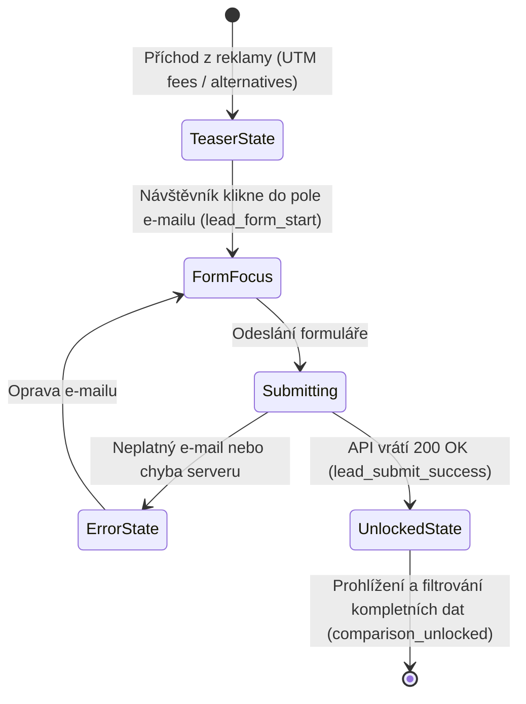

# AI Log – Záznam 00: Návrh aplikace a konverzního procesu

**Datum:** 27. 10. 2026  
**Nástroj:** Google Antigravity IDE (Gemini 3.8 Flash)  
**Téma:** Návrh konceptu, cílové skupiny, lead magnetu a uživatelské cesty

---

>  **Poznámka k formátu a anotaci:**  
> Tento dokument zachycuje kompletní průběh 1. konverzace při návrhu ETF landing page.  
> - **User:** Zadání a reakce uživatele (autora projektu).  
> - **MODEL:** Návrhy, analýzy a odpovědi AI agenta (Google Antigravity IDE / Gemini 3.8 Flash).  

---

## 1. Vymezení zadání a strategický koncept

###  User:
Tvým úkolem je pomoct mi navrhnout a vytvořit landing page s porovnáním ETF obchodovaných na NYSE pro českého drobného investora, který přichází z reklamy na mobilu a stránce věnuje jen několik vteřin.


Stránka musí fungovat jako lead magnet. Návštěvníkovi musí nabídnout konkrétní hodnotu a výměnou za ni získáme jeho kontakt. Hezký design nestačí, hlavním cílem je získat co nejvíce relevantních kontaktů. Zároveň nechci, aby stránka působila jako generický výstup od AI. Design, texty i celkové rozložení musí být promyšlené pro tuto cílovou skupinu.


Zatím nechci, abys rovnou začal programovat celou aplikaci. Nejdřív bych chtěl promyslet, jak k zadání přistoupit, koho přesně oslovuju, jakou hodnotu návštěvníkovi nabídneme a jak ho přirozeně dovedeme k odeslání kontaktu.


Vysvětli mi svůj návrh a zdůvodni důležitá rozhodnutí. Upozorni také na případné nejasnosti a předpoklady, které bude potřeba ověřit. Potom na základě návrhu rozhodneme, jak pokračovat.

---

###  MODEL (Antigravity):
Tento přístup dává skvělý smysl. U mobilního návštěvníka z reklamy rozhodují první 3 vteřiny a generický e-book „Průvodce investováním pro začátečníky“ má dnes konverzi blížící se nule. 

Zde je strategický návrh konceptu, postavený na psychologii českého retailového investora a specifikách mobilního provozu.

---

### 1. Klíčový paradox trhu: Proč je téma „NYSE ETF pro Čechy“ obrovská příležitost

Než začneme kreslit layout, musíme vyřešit zásadní faktickou a regulatorní věc:
* **Evropská regulace (PRIIPs / MiFID II):** Běžný český retailový investor si na 99 % brokerů (XTB, Trading 212, Portu, Fio, DEGIRO) **nemůže přímo koupit americká ETF kótovaná na NYSE/Nasdaq** (např. *VOO, SPY, SCHD, QQQ, JEPI*), protože americké fondy nevydávají evropský dokument klíčových informací (KID).
* **Běžná frustrace z reklamy:** Lidé vidí na TikToku/YouTube video o dividendovém králi *SCHD* nebo fondu *VOO*, otevřou brokera v ČR a systém jim napíše: *„Tento instrument není pro retailové klienty v EU dostupný.“*
* **Naše zbraň (Value Proposition):** 
  Pokud lead magnet postavíme jako:
  > **„Srovnání nejlepších ETF z NYSE a jejich přesných evropských (UCITS) alternativ, které si v ČR reálně můžete koupit v CZK, bez poplatků a s osvobozením od daní po 3 letech.“**

  Tímto okamžitě trefujeme reálnou bolest, prokazujeme hlubokou znalost lokálního trhu a návštěvník okamžitě chápe, proč to pro něj má cenu zlata.

---

### 2. Kdo je cílová skupina z mobilní reklamy?

Návštěvník z mobilu nečte romány. Scrolluje v tramvaji, na gauči nebo v pauze na oběd.

* **Profil:** Čech 25–45 let, má volné peníze (od 1 000 do 20 000 Kč měsíčně), inflace mu požírá úspory na spořicím účtu.
* **Stav mysli:** 
  * Chce výnos amerického trhu, ale bojí se, že vybere špatně.
  * Bojí se skrytých poplatků a daní (neví, co je časový test 3 roky nebo W-8BEN formulář).
  * Je skeptický vůči „krypto guru“ a podezřelým nabídkám rychlého zbohatnutí.
* **Co ho přesvědčí:** Transparentnost, reálná data (graf / srovnávací tabulka), srozumitelná čeština bez složitého žargonu a okamžitá užitečnost.

---

### 3. Jaký lead magnet nabídneme (Proč e-booky nefungují)

Místo nudného 30stránkového PDF, které nikdo na mobilu nečte, navrhuji **jeden ze dvou formátů s vysokou konverzí**:

#### Varianta A: „Interaktivní tahák 2026: NYSE vs. UCITS ekvivalenty pro Čechy“ (Doporučeno)
* **Co to je:** Přehledná, vizuální jednostránková srovnávací matice (formát optimalizovaný pro displej mobilu nebo Notion/PDF tabulka).
* **Obsah:**
  1. **Top 10 amerických ETF** (VOO, VTI, QQQ, SCHD, JEPI...) a jejich **přesné evropské alternativy** (např. SXR8, VUAA, QDVE, FUSD).
  2. **Srovnání nákladů (TER):** Kolik skutečně fond stojí ročně.
  3. **Akumulační (Acc) vs. Distribuční (Dist):** Která varianta je v ČR výhodnější kvůli daním z dividend vs. 3letému časovému testu.
  4. **Kde je koupit v ČR s 0% poplatkem:** Porovnání 3 nejvyužívanějších brokerů pro Čechy.

#### Varianta B: „Mikro-kvíz se zamčeným výsledkem“ (Micro-Quiz Funnel)
* Návštěvník přímo na landing page klikne na 2 jednoduché volby (např. *Cíl: Růst vs. Pravidelná dividenda* -> *Horizont: Do 5 let vs. 10+ let*).
* Výsledek: Ukážeme mu náhled vítězného ETF, ale pro kompletní srovnání a detailní rozpis poplatků zadá e-mail. (Tento trychtýř mívá o 30–50 % vyšší konverzi než statický formulář, protože uživatel investoval mikrokrok).

---

### 4. Struktura stránky pro mobil (Sekundu po sekundě)

Abychom udrželi pozornost během prvních 3–5 vteřin:

```
[ 0–3 sekundy: HERO SEKCIE (Above the Fold) ]
--------------------------------------------------
Malý badge: 🇨🇿 Aktualizováno pro rok 2026 | Český daňový test
HLAVNÍ TITULEK: 
"Chcete investovat do amerických ETF jako VOO nebo SCHD?
Zde je srovnání a jejich evropské alternativy dostupné v ČR."

SUBTITULEK (1 věta):
"Přehledný tahák pro drobného investora: Která ETF se vyplatí, 
jak se vyhnout daním a u kterých brokerů neplatíte poplatky."

VIZUÁLNÍ PRVEK: 
Interaktivní minináhled tabulky (Ticker | Výnos p.a. | Dostupnost v ČR)
s rozmazanými prémiovými řádky (FOMO efekt).

PRIMÁRNÍ CTA:
[ Chci srovnání TOP ETF zdarma do e-mailu ]
(Případně rovnou 1 pole: Zadejte e-mail -> Odeslat)
--------------------------------------------------

[ 3–8 sekund: HÁČEK & ODBORNOST (Social Proof & Pain Points) ]
--------------------------------------------------
3 rychlé odrážky s ikonami:
✓ Proč vám český broker nedovolí koupit přímo US ticker (a jaké UCITS ETF zvolit)
✓ Která varianta splňuje 3letý daňový test (abyste neodváděli 15 % státu)
✓ Kde koupit tato ETF za české koruny bez poplatku za směnu

--------------------------------------------------
[ 8–15 sekund: UKÁZKA ZDARMA (Ochutnávka dat) ]
--------------------------------------------------
Ukažme 2 ETF zcela otevřeně (např. S&P 500 – VOO vs. VUAA), 
aby viděl, že data mají obrovskou hodnotu. 
Zbylých 8 (včetně dividendových a technologických) je "odemknuto" po odeslání.

--------------------------------------------------
[ ZÁVĚR: RYCHLÝ FORMULÁŘ + DŮVĚRA ]
--------------------------------------------------
Formulář s jedním polem (E-mail).
Mikrotext: "Okamžité doručení. Žádný spam ani nevyžádané telefonáty."
Právní disclaimer o investičních rizicích (povinnost a zároveň prvek serióznosti).
```

---

### 5. Důležité nejasnosti a předpoklady k ověření

Než navrhneme konkrétní texty a vizuál, potřebuji od vás ujasnit 3 klíčové otázky:

1. **Co se stane s kontaktem po odeslání? (Obchodní model)**
   * Chcete sbírat pouze **e-mail** (pro budování newsletteru, affiliate prodej brokerů typu XTB/Trading 212/Portu)?
   * Nebo potřebujete i **telefonní číslo**, protože leady bude obvolávat finanční poradce / zprostředkovatel? *(Pozor: Vyžadování telefonu na mobilu sníží konverzi o 40–60 %, ale leady jsou výrazně hodnotnější).*

2. **Kdo je autorem / provozovatelem stránky?**
   * Vystupuje stránka jako **nezávislý finanční projekt / srovnávač**, nebo pod **konkrétní značkou / jménem poradce**? (V Česku funguje osobní tvář nebo nezávislý analytický brand mnohem lépe než anonymní korporátní web).

3. **Technické a obsahové zaměření:**
   * Vyhovuje vám koncept srovnání **US ETF z NYSE vs. jejich dostupné UCITS ekvivalenty**, nebo máte specifický způsob, jak retailovým Čechům reálně kupovat přímo instrumenty z NYSE (např. přes profesionální účet, opce, nebo specifického zahraničního brokera)?

Jakmile si tyto 3 body ujasníme, připravím konkrétní wireframe, přesné prodejní texty a následně vizuální návrh.

---

## 2. Definice cílové skupiny, narativu (boj s inflací) a parametrů sběru kontaktu

###  User:
Ten koncept amerických ETF a jejich evropských alternativ se mi líbí hlavně díky tomu že to můžeme propagovat jakož to boj proti inflaci pro každodení ho člověka co si chce zachránit úspory. Než se ale posuneme k wirefremu, potřebujeme ještě promyslet celý proces od příchodu návštěvníka až po získání kontaktu, nejen samotnou nabídku.

Pro začátek bych počítal stím, že budeme sbírat pouze email

---

###  MODEL (Antigravity):
Skvělé rozhodnutí. Zaměření na **„záchranu úspor před inflací pro běžného člověka“** v kombinaci se sběrem **pouze e-mailu** je ideální kombinace. 

Sbírat jen e-mail dramaticky snižuje tření: na mobilu člověku klávesnice nabídne jeho e-mail jedním kliknutím (autofill), takže odpadá bariéra psaní.

Abychom ale z reklamy nevytěžili jen „levné, ale zbytečné kliky“, musíme celý proces navrhnout jako **psychologický most**: od frustrace z mizejících úspor až po pocit úlevy, že má v ruce konkrétní a bezpečný plán.

Zde je detailně rozpracovaný celý proces krok za krokem:

---

### Fáze 0: Reklama na mobilu (Odkud přichází a co čeká)
Úspěch landing page ze 70 % závisí na tom, co bylo v reklamě (**tzv. Message Match**). Pokud reklama slíbí záchranu úspor, stránka nemůže začít suchou finanční hantýrkou.

* **Úhel reklamy (Hook):** 
  * *„Spořicí účet nestačí a bankovní fondy vám sežerou zisk na poplatcích. Zjistěte, jak si běžný Čech může koupit kousek největších amerických firem už od 500 Kč měsíčně.“*
* **Očekávání návštěvníka:** Hledá jednoduchý, srozumitelný návod bez bankovních kliček. Je ve střehu, jestli to není podvod.

---

### Fáze 1: Příchod na stránku (0–3 vteřiny) – Zastavení reflexu „Zpět“
Mobilní uživatel má prst připravený na gesto „zpět“. Potřebujeme ho okamžitě ukotvit a potvrdit mu, že je na správném místě.

* **Psychologický stav:** *„Mám na to pár vteřin, je to pro mě?“*
* **Co musí vidět bez scrollování (Above the Fold):**
  1. **Jasný headline spojující inflaci a řešení:** Žádné metaforické slogany. Příklad: *„Jak ochránit úspory před inflací pomocí amerických ETF (jednoduše a v korunách)“*.
  2. **Český kontext:** Zmínka o 3letém daňovém testu a nulových poplatcích – to okamžitě odfiltruje podezření ze zahraničního spamu.
  3. **Vizuální kotva:** Malý, čistý náhled tabulky/taháku, který ukazuje, že tady jsou **reálná data**, ne prázdné marketingové řeči.

---

### Fáze 2: Uvědomění problému (3–8 vteřin) – Pojmenování nepřítele
Než nabídneme řešení, musíme validovat jeho frustraci.

* **Psychologický stav:** *„Proč to vlastně neudělám přes svoji banku?“*
* **Stručné vypíchnutí 2 zásadních pastí:**
  1. **Past č. 1: Bankovní podílové fondy.** Banka si vezme 1,5–2,5 % ročně na poplatcích, ať už trh roste nebo padá. Za 10 let vám to sežere třetinu zisku.
  2. **Past č. 2: Americká ETF mají háček.** Lidé slyší o fondu *VOO* nebo *SCHD*, ale v Česku jim aplikace napíše, že nákup není povolen. Většina lidí to v této fázi vzdá.
* **Výsledek:** Návštěvník si řekne: *„Aha! Přesně tohle se mi stalo / Přesně tohohle jsem se bál.“* Získáváme jeho plnou pozornost.

---

### Fáze 3: Nabídka hodnoty a ochutnávka (8–15 vteřin) – Důkaz místo slibů
Tady většina webů udělá chybu a řekne: *„Zadejte e-mail a my vám to pošleme.“* To nefunguje, protože uživatel ještě neví, jestli ta data za jeho e-mail stojí.

* **Strategie „Ochutnávka zdarma“ (Freemium Teaser):**
  * Přímo na stránce ukážeme **1 konkrétní příklad z taháku zdarma**:
    * *Populární americké ETF:* **VOO (S&P 500)**
    * *Dostupná evropská alternativa pro ČR:* **VUAA nebo SXR8**
    * *Poplatek:* Pouhých 0,07 % ročně (oproti 2 % v bance)
    * *Daně:* 0 % daň z příjmu po 3 letech držení.
  * **Aha-moment:** Návštěvník vidí, že data jsou extrémně praktická, přesná a reálná.
* **Přechod k lead magnetu:** 
  * *„Tohle je jen 1 z 10 prověřených ETF. Připravili jsme pro vás kompletní srovnání: dividendové stálice, technologické růstové fondy i konzervativní ochranu před krizí.“*

---

### Fáze 4: Konverze – Zadání e-mailu (15–25 vteřin)
Formulář musí mít absolutně nulové tření.

* **Vstupní pole:** Pouze 1 rámeček: `Váš e-mail`.
* **Text tlačítka (CTA):** Nikdy ne generické „Odeslat“. Musí vyjadřovat okamžitý zisk:
  * *„Získat srovnávací tahák ETF zdarma ➔“*
* **Mikro-ujištění pod tlačítkem:**
  * 🔒 *„Žádný spam. 1 kliknutím se můžete kdykoliv odhlásit. Tahák dorazí do 2 minut.“*

---

### Fáze 5: Co se stane PO odeslání (Klíč k dlouhodobému úspěchu)
Tady spousta projektů selhává – ukážou jen strohou hlášku „Děkujeme“. Přitom právě tady je pozornost uživatele na maximu!

1. **Okamžitá stránka s poděkováním (Thank You Screen):**
   * Jasná instrukce: *„Tahák jsme vám právě odeslali na [e-mail]. Zkontrolujte složku Doručené (případně Hromadné / Promo akce).“*
   * **Okamžitá hodnota na obrazovce:** Aby nemusel čekat na e-mail, dáme mu poděkování a rovnou tlačítko: *„Otevřít tahák online hned“* (např. interaktivní zobrazení nebo přímý odkaz).
2. **První e-mail v jeho schránce:**
   * Doručení do 60 vteřin.
   * Odesílatel: Konkrétní jméno (např. *Petr z [Projekt]*), nikoliv robotický `noreply@`.
   * Předmět: *„[Tahák ETF] Srovnání amerických ETF a evropských alternativ pro rok 2026“*.
   * Obsah: Přímý odkaz na stažení / prohlížení + krátká osobní zpráva, jak s tím naložit za 5 minut.

---

### Shrnutí klíčových rozhodnutí pro náš proces:

| Krok | Cíl kroku | Hlavní eliminované riziko |
| :--- | :--- | :--- |
| **Reklama ➔ H1** | Message match (boj s inflací pro běžného člověka) | Okamžitý odchod kvůli zmatení |
| **Pojmenování problému** | Proč banky berou moc a proč US ETF v ČR nejdou | Pocit, že ETF jsou moc složitá |
| **Ochutnávka dat** | Ukázat 1 ETF srovnání otevřeně zdarma | Pocit, že tahák je jen prázdný marketing |
| **Formulář** | 1 pole (pouze e-mail) s autofillem | Tření a nechuť vyplňovat formuláře |
| **Poděkování** | Okamžitý přístup k datům + doručení do schránky | Ztráta zájmu a zapomenutí na značku |

Dává vám tento myšlenkový tok z pohledu návštěvníka smysl? Pokud ano, v dalším kroku můžeme přejít k **textovému wireframu (konkrétním titulkům, odrážkám a obsahu jednotlivých sekcí)**.

---

## 3. Zapojení projektových mantinelů (README.md, NYSE vs. NYSE Arca)

###  User:
jak si můžeš všimnout přibylo README a ai log společně s readme tak si oboje přečti

*Kontext k akci AI:* Model prozkoumal adresářovou strukturu projektu, načetl pravidla z `README.md` i `ai-log/README.md` a analyzoval stanovené mantinely.

---

###  MODEL (Antigravity):
Přečetl jsem podrobně jak [README.md](file:///d:/GitHub/etf-landingpage/README.md), tak strukturu v [ai-log/](file:///d:/GitHub/etf-landingpage/ai-log/README.md). 

Tento dokument dává celému projektu jasný, metodicky velmi čistý a profesionální rámec. Odstraňuje dohady a stanovuje přesná pravidla hry.

Zde je shrnutí nejdůležitějších zjištění a mantinelů, které z [README.md](file:///d:/GitHub/etf-landingpage/README.md) plynou a kterých se budeme striktně držet:

---

### 1. Zásadní faktický mantinel: Primární burza NYSE (vs. NYSE Arca)
V [README.md](file:///d:/GitHub/etf-landingpage/README.md#L47-L50) je explicitně uvedeno:
> *„Do hlavního srovnání budou zařazeny pouze ETF skutečně obchodované na NYSE. ETF obchodované na NYSE Arca, Nasdaq nebo jiných amerických burzách nebudou do hlavního výběru zahrnuty.“*

* **Proč je to kritické:** Většina běžných retailových ETF (např. *SPY, VOO, VTI*) se totiž technicky obchoduje na burze **NYSE Arca** (elektronická platforma pro ETF), nikoliv na hlavní **NYSE** (New York Stock Exchange). 
* **Dopad na data:** Musíme si dát velký pozor na oficiální registr NYSE a ověřit, které fondy mají primární listing skutečně na **NYSE** (např. některé specifické uzavřené fondy / CEFs, nebo vybraná ETF kotovaná přímo na NYSE), případně precizně doložit burzu ze stránek emitenta/burzy, aby nenastala faktická chyba.

---

### 2. Dvě přesné cesty z reklamy (Dynamický Hero podle UTM)
Místo jedné obecné stránky počítáme v [README.md](file:///d:/GitHub/etf-landingpage/README.md#L127-L186) s dynamickým přizpůsobením první obrazovky podle parametru v URL:

1. **Varianta A (`utm_content=fees`):**
   * **Úhel:** Nákladovost fondů (*„Kolik stojí ETF, které sledujete?“*).
   * **Hero H1:** *„Porovnejte nákladovost vybraných ETF obchodovaných na NYSE.“*
   * **Důraz na stránce:** TER (Total Expense Ratio), srovnání poplatků, skryté náklady.
2. **Varianta B (`utm_content=alternatives`):**
   * **Úhel:** Hledání evropských alternativ (*„Hledáte evropskou alternativu k americkému ETF?“*).
   * **Hero H1:** *„Hledáte evropskou alternativu k americkému ETF?“*
   * **Důraz na stránce:** UCITS fondy, stejný index vs. podobná strategie, burza evropského fondu.

---

### 3. Integrovaný konverzní a analytický trychtýř
Celý proces má přesně navržené měření s 5 klíčovými událostmi, bez posílání PII (e-mailů):

**Příchod** (`landing_view`) ➔ **Interakce s tabulkou** (`comparison_interaction`) ➔ **Focus na formulář** (`lead_form_start`) ➔ **Uložení kontaktu** (`lead_submit_success`) ➔ **Stažení PDF** (`resource_download`)

* **Důležitá technická podmínka:** Událost `lead_submit_success` se **nesmí** vystřelit pouhým kliknutím na tlačítko, ale až po potvrzeném uložení e-mailu.

---

### 4. Věcná poctivost vůči investorovi (Žádný marketingový „hype“)
V [README.md](file:///d:/GitHub/etf-landingpage/README.md#L61-L66) je stanoven vysoký etický a odborný standard:
* Netvrdit, že fondy jsou totožné, pokud se liší indexem či strategií.
* Neslibovat dostupnost u všech brokerů.
* U každého čísla evidovat zdroj, datum ověření a metodiku.
* Výstupem po odeslání e-mailu je **kompletní přehled ve formátu PDF**.

---

### Doporučený další postup

Abychom postupovali logicky a systematicky:

1. **Krok 1: Výběr a ověření dat (fondy na NYSE)**
   * Najít a ověřit konkrétní ETF splňující podmínku přímého listingu na NYSE + dohledat k nim odpovídající evropské UCITS alternativy s uvedením indexu a TER.
2. **Krok 2: Textový wireframe stránky**
   * Sestavit kompletní textaci obou variant Hero sekce, ukázky srovnání, lead magnetu a děkovacího stavu s odkazem na PDF.
3. **Krok 3: Záznam do `ai-log/00-navrh-aplikace.md`**
   * Pomohu vám připravit strukturovaný zápis naší dosavadní diskuse a rozhodnutí do připraveného logu, abyste měl kompletní dokumentaci pro odevzdání.

Můžeme se nyní pustit do **Kroku 1 (prověření konkrétních fondů a burz)**, nebo preferujete nejdříve doladit **Krok 2 (textový wireframe)**?

>  **Poznámka**  
> *(Antigravity zmínilo PDF což ano to jsem psal do původního readme jenže z ohledem zpětně mi to nedávalo logiku když "uživatel" nebo zpíš osoba co přešla z reklamy na stránku neni asi někdo kdo by si zrovna pdf četl takže mi lepší přišlo interaktivní porovnání co se kompletně zobrazí právě po tom odeslání emailu.)*

---

## 4. Přehodnocení formy lead magnetu: Zrušení PDF a přechod na on-page odemknutí

###  User:
Co se readme týče to pdf se mi moc nelíbí když nad tím zpětně přemýšlím radši bych chtěl něco ve stylu:

Pracovním konceptem je interaktivní srovnání vybraných ETF obchodovaných na NYSE a jejich relevantních evropských alternativ.

Návštěvník si může prohlédnout ukázku dat a pracovat se srovnáním přímo na stránce. Po zadání e-mailu a úspěšném uložení kontaktu se mu zpřístupní kompletní výsledky včetně zdrojů, nákladovosti a vysvětlení důležitých rozdílů.

Hlavní hodnotou není stažitelný dokument, ale možnost rychle se zorientovat v konkrétních fondech bez nutnosti samostatně procházet jejich dokumentaci

takže to bych chtělo v tom readme upravit

*Kontext k akci AI:* Model provedl úpravu v `README.md` (sekce Nabízená hodnota, Uživatelská cesta, Měření a Testování), kde nahradil koncept PDF interaktivním on-page odemknutím s událostí `comparison_unlocked`.

---

###  MODEL (Antigravity):
Úpravu v [README.md](file:///d:/GitHub/etf-landingpage/README.md) jsem provedl. 

Tato změna dává z hlediska mobilního UX i byznysového cíle obrovský smysl:
1. **Eliminace mobilního tření:** Stahování PDF na mobilu často ztroskotá (stáhne se do skryté složky, otevře se v cizí aplikaci, je na displeji nečitelné nebo si uživatel zavře prohlížeč).
2. **Okamžitá odměna (Instant Gratification):** Návštěvník vidí 2 srovnání otevřená a další se zámečkem. Zadá e-mail, klikne a data se přímo před jeho očima plynule odemknou. To působí moderně a drží ho to na stránce.
3. **Měřitelnost:** Místo pasivního stažení souboru (`resource_download`) nyní přesně měříme událost `comparison_unlocked` a můžeme sledovat, jak uživatel dál filtruje a zkoumá odemčená data.

V [README.md](file:///d:/GitHub/etf-landingpage/README.md) jsem upravil:
* Sekci **Nabízená hodnota** (přesně podle vašeho textu).
* Sekci **Návrh uživatelské cesty** (krok 5: odemknutí kompletních výsledků přímo na stránce).
* Sekci **Měření konverzního procesu** (nahrazení události `resource_download` za `comparison_unlocked`).
* Sekci **Testování a nasazení** (kontrola funkčnosti odemknutí po odeslání).

---

### Další krok: Ověření dat (fondy přímo na NYSE)

Jakmile jste připraven, můžeme se pustit do výběru a ověření konkrétních fondů. 

Vzhledem k přísnému pravidlu v README (*pouze ETF skutečně obchodované na NYSE, nikoliv NYSE Arca*):
* Můžeme prověřit oficiální databázi NYSE a vybrat **3–4 reprezentativní ETF kótovaná přímo na NYSE** pokrývající různé investiční strategie (např. stabilní dividendy, technologie, široký trh).
* K nim dohledáme **evropské UCITS alternativy** (např. kótované na Xetra/Euronext) s jejich přesným TER, sledovaným indexem a rozdíly.

Zároveň máme prázdný soubor [ai-log/00-navrh-aplikace.md](file:///d:/GitHub/etf-landingpage/ai-log/00-navrh-aplikace.md) – chcete, abych do něj připravil strukturovaný záznam naší dosavadní konverzace a rozhodnutí, abyste k němu mohl doplnit své vlastní poznámky pro odevzdání?

>  **Poznámka**  
> *(S prominutím jsem antigravity uplně ignoroval protože nejdřív jsem chtěl vyřešit ten fakt že nemám jak zaznamenávat konverzace nebo spíš neměl.)*

---

## 5. Rozdělení projektu do tematických konverzací a specifikace Next.js architektury

###  User:
co chci je rozdělit tendle celý úkol na více konverzací aby každá jedna konverzace udělal nákou implementaci v tédle řešíme jak to funguje další může být třeba základní nastavení techonologii co budou použity zatím zvažuji Nextjs už jen z toho důvodu že se dá krásně implementovat API

---

> **Poznámka**
> *( Antigravity sice chtělo udělat něco v co jsem doufal že bude transcript konverzace ale ve finálé to bylo jenom odfláklý přepis což neni to co jsem chtěl takže co jsem musel udělat bylo jít to .gemini/antrigraviyt-ide/brain/{hash dané konverzace}/.system_generated/logs a tam jsem potom vzal transcript_full.jsonl který jsem protáhl přez antigravity znova aby z toho vznikl tendle přepis co je čitelný a zároveň splňuje to co dělá /export pro claude)*

###  MODEL (Antigravity):
Rozdělení práce do samostatných konverzací je **vynikající přístup**. 

V praxi to zabrání zahlcení kontextu, udrží každý krok přísně zaměřený a hlavně vám to vytvoří perfektně strukturovaný `ai-log` pro každý milník projektu.

Next.js je pro tento účel skvělá volba:
* Má v sobě nativní **Route Handlers / API routes** (`POST /api/lead`), takže nepotřebujete stavět samostatný backend pro sběr e-mailů.
* Skvěle řeší SSR / statický export s rychlým načtením na mobilu (klíčové pro první 3 vteřiny z reklamy).
* Vercel deployment je nativní záležitost na jedno kliknutí.

---

### Doporučený plán jednotlivých konverzací:

| Konverzace | Téma a výstup |
| :--- | :--- |
| **1. Konverzace (TATO)** | **Jak to funguje:** Detailní stavový diagram, uživatelský tok, pravidla odemykání dat, API logika a záznam do `ai-log/00-navrh-aplikace.md`. |
| **2. Konverzace** | **Technologie a inicializace:** Nastavení Next.js, struktura složek, příprava `/api/lead` a layoutu. |
| **3. Konverzace** | **Data a ověřování:** Výběr a doložení konkrétních NYSE ETF a UCITS alternativ se zdroji. |
| **4. Konverzace** | **Implementace UI a interakce:** Mobilní layout, dynamický Hero (UTM), tabulka s ochutnávkou, animace odemknutí, analytické eventy. |
| **5. Konverzace** | **Testování a nasazení:** Validace, chybové stavy, test na mobilu, Vercel deploy a uzavření dokumentace. |

---

### Finální návrh: Jak přesně aplikace funguje (pro uzavření této konverzace)

Abychom v této konverzaci měli 100% uzavřenou funkční logiku, definujeme **4 stavy stránky a datový tok**:



#### 1. Stav „Teaser“ (Před zadáním e-mailu)
* **Hero sekce:** Podle parametru `utm_content` v URL se zobrazí varianta A (*nákladovost*) nebo varianta B (*alternativy*). Pokud parametr chybí, zobrazí se výchozí varianta.
* **Srovnávací komponenta:**
  * Zobrazuje **2 vybrané dvojice fondů v plném detailu** (ochutnávka: US fond vs. UCITS alternativa, nákladovost, burza, sledovaný index, rozdíly a zdroje).
  * Další řádky jsou v tzv. **zamčeném stavu** (např. poloprůhledné/rozostřené řádky se symbolem zámku a štítkem strategie – např. *Dividendové stálice*, *Technologický růst*).
* **Konverzní blok:** Jediné pole pro e-mail s textem: *„Zadejte e-mail pro okamžité odemknutí kompletního srovnání všech fondů.“*

#### 2. Stav „Submitting“ (Odesílání kontaktu)
* Klientská validace formátu e-mailu.
* Tlačítko přejde do stavu `loading` (zabrání se vícenásobnému kliknutí).
* `POST /api/lead` odešle e-mail na server.

#### 3. Stav „Unlocked“ (Odemčeno přímo na stránce)
* **Okamžitá odezva bez reloadu:** Žádné přesměrování na jinou URL.
* Zámky a rozostření u tabulky plynule zmizí.
* Zpřístupní se kompletní databáze fondů, včetně možnosti rychlého filtrování.
* Konverzní formulář se transformuje na diskrétní banner úspěchu: *„✓ Kompletní srovnání je odemčeno. Odkaz na tuto stránku jsme vám pro jistotu poslali i na váš e-mail.“*
* Spustí se analytické události `lead_submit_success` a následně `comparison_unlocked`.

#### 4. Ochrana a chybové stavy
* Pokud API selže (např. výpadek sítě), zobrazí se přátelská chybová zpráva a zadaný e-mail zůstane v poli, aby ho uživatel nemusel psát znovu.
* Anti-spam ochrana: Tiché „honeypot“ pole (skryté pole, které lidé nevidí, ale boti ho vyplní).

---

Nyní vytvořím záznam tohoto návrhu do [ai-log/00-navrh-aplikace.md](file:///d:/GitHub/etf-landingpage/ai-log/00-navrh-aplikace.md), abyste měl zdokumentovaný tento první krok.

---

Záznam z této první fáze jsem uložil do [ai-log/00-navrh-aplikace.md](file:///d:/GitHub/etf-landingpage/ai-log/00-navrh-aplikace.md). Zahrnuje veškerá klíčová rozhodnutí, vysvětlení změn (včetně přechodu z PDF na on-page odemknutí), návrh stavového automatu i prostor pro vaše vlastní poznámky a zhodnocení.

### Shrnutí stavu této konverzace:
1. **Koncept a cíl:** Máme vyjasněnou cílovou skupinu, psychologii mobilního návštěvníka i funkční mechanismus lead magnetu (ochutnávka ➔ zadání e-mailu ➔ okamžité odemknutí dat).
2. **Aktualizované [README.md](file:///d:/GitHub/etf-landingpage/README.md):** Všechny sekce přesně odrážejí interaktivní odemknutí na stránce a novou analytickou událost `comparison_unlocked`.
3. **Dokumentace v [ai-log/00-navrh-aplikace.md](file:///d:/GitHub/etf-landingpage/ai-log/00-navrh-aplikace.md):** Kompletně zaznamenáno pro účely odevzdání.

Tímto máme fázi **„Jak to funguje“** kompletně hotovou a připravenou.

Až budete chtít, můžete otevřít **novou konverzaci**, kde se zaměříme čistě na **inicializaci technologií (Next.js, nastavení API routy `/api/lead` a základní kostru projektu)**.